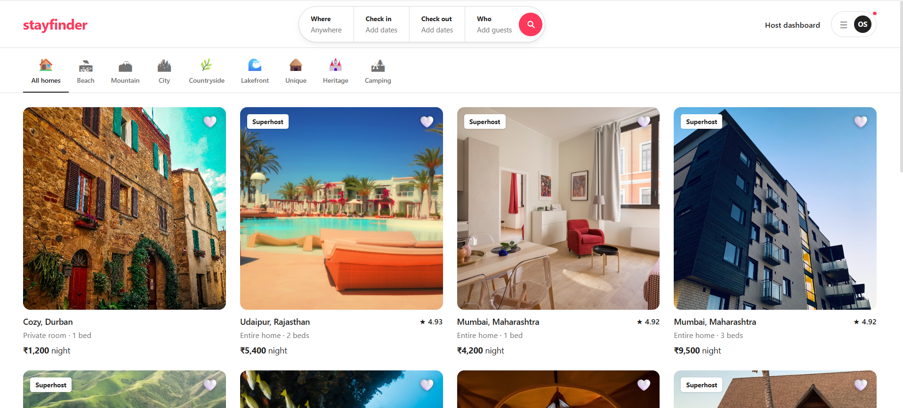
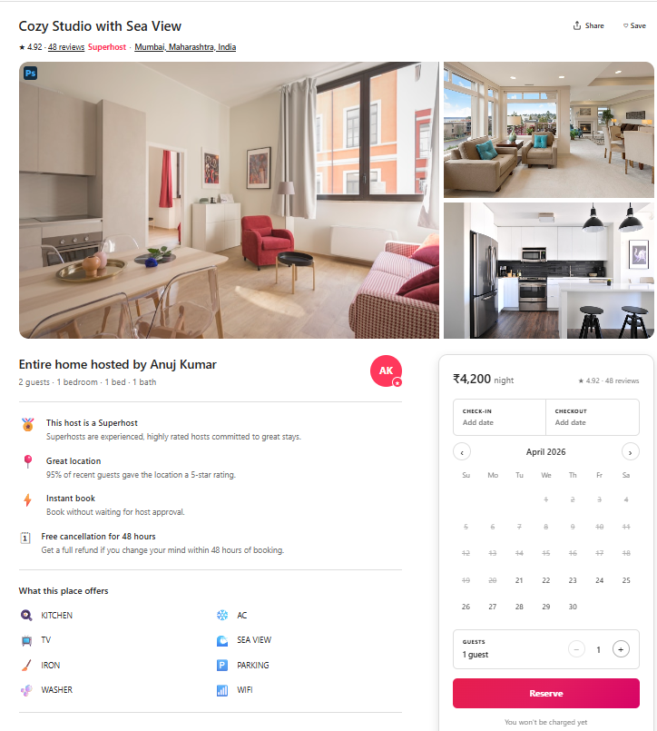
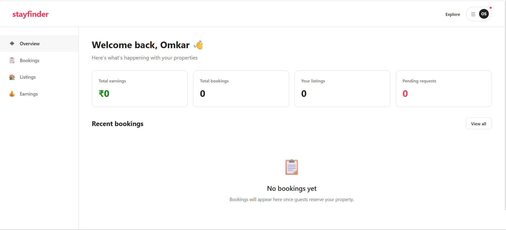
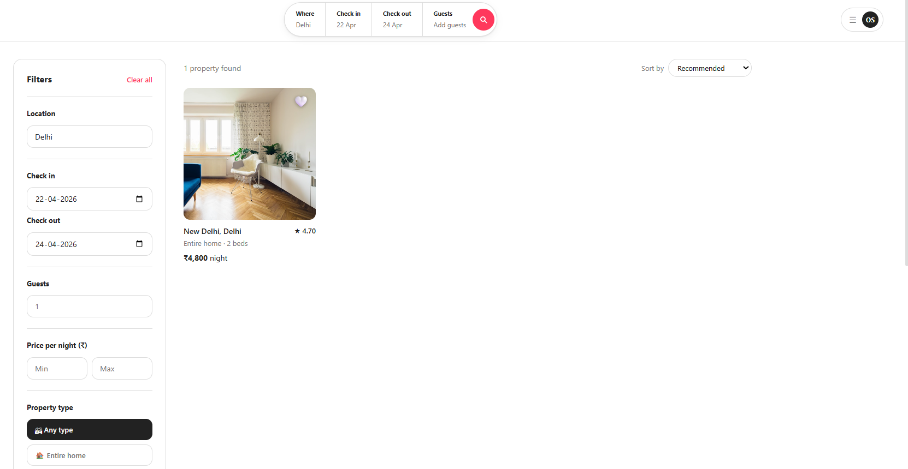
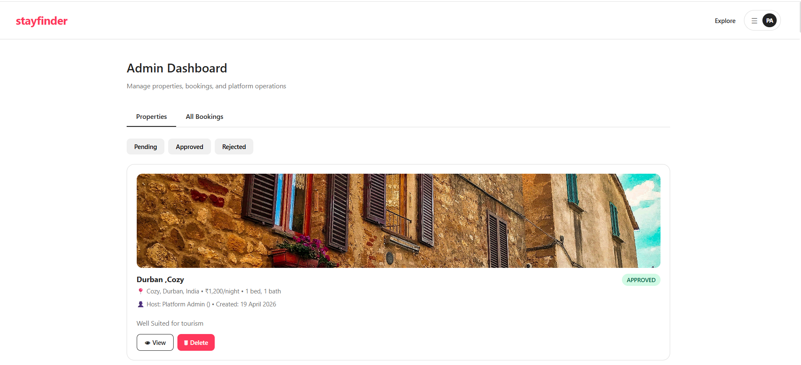
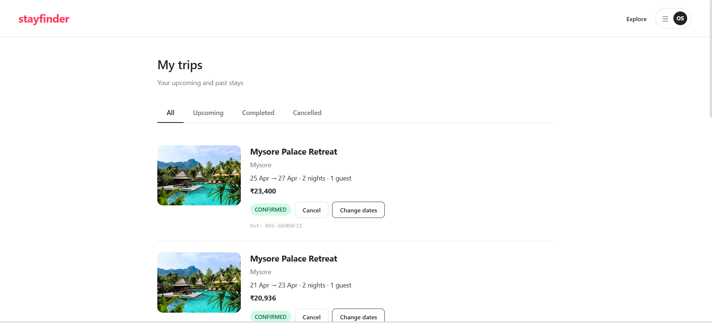

<div align="center">


<br/><br/>

```
███████╗████████╗ █████╗ ██╗   ██╗███████╗██╗███╗   ██╗██████╗ ███████╗██████╗
██╔════╝╚══██╔══╝██╔══██╗╚██╗ ██╔╝██╔════╝██║████╗  ██║██╔══██╗██╔════╝██╔══██╗
███████╗   ██║   ███████║ ╚████╔╝ █████╗  ██║██╔██╗ ██║██║  ██║█████╗  ██████╔╝
╚════██║   ██║   ██╔══██║  ╚██╔╝  ██╔══╝  ██║██║╚██╗██║██║  ██║██╔══╝  ██╔══██╗
███████║   ██║   ██║  ██║   ██║   ██║     ██║██║ ╚████║██████╔╝███████╗██║  ██║
╚══════╝   ╚═╝   ╚═╝  ╚═╝   ╚═╝   ╚═╝     ╚═╝╚═╝  ╚═══╝╚═════╝ ╚══════╝╚═╝  ╚═╝
```

### 🏠 A full-stack AI-powered Airbnb-inspired property rental platform
### *🤖 Google Gemini AI · Real-time notifications · JWT auth · Cloudinary uploads · Email alerts · Admin panel · PWA · Map view · Chat*

<br/>

[🚀 Quick Start](#-quick-start) · [🤖 AI Features](#-ai-features-powered-by-google-gemini) · [✨ Features](#-features) · [🏗 Architecture](#-architecture) · [📡 API Reference](#-api-reference) · [🛠 Tech Stack](#-tech-stack) · [📸 Screenshots](#-screenshots)

</div>

---

## 📖 Overview

**StayFinder** is a production-grade AI-powered Airbnb clone built with **Spring Boot 3**, **Google Gemini AI**, and **Vanilla JS**. It implements the complete rental marketplace workflow — from AI-generated property descriptions and smart pricing to booking, review summaries, real-time notifications, and host/guest chat — with a clean REST API, WebSocket push, map view, PWA support, and a responsive frontend served through nginx.

> Built as a full-stack portfolio project demonstrating enterprise Java patterns, AI integration, security best practices, real-time communication, and modern frontend architecture.

---

## 🤖 AI Features (Powered by Google Gemini)

StayFinder leverages **Google Gemini AI (gemini-2.5-flash)** to provide intelligent, production-ready features that rival major platforms like Airbnb and Booking.com.

### ✨ AI Property Description Generator
**For Hosts** · *Save time, create professional listings*

- 🎯 **What**: Generates compelling 3-4 sentence property descriptions
- 🔧 **How**: Analyzes location, amenities, capacity, and property type
- 📍 **Where**: Host Dashboard → Add Listing → "✨ AI Generate" button
- 🚀 **API**: `POST /api/v1/host/properties/generate-description`

**Example Output**:
```
"Experience luxury in the heart of Mumbai with this stunning 2-bedroom 
apartment. Perfect for families or business travelers, featuring modern 
amenities including WiFi, AC, and a fully equipped kitchen. Located in 
a prime business district with excellent connectivity."
```

### 📊 AI Review Summary
**For All Users** · *Quick insights from guest reviews*

- 🎯 **What**: Summarizes all reviews into one concise sentence (15-20 words)
- 🔧 **How**: Highlights common positive themes and specific aspects
- 📍 **Where**: Search results & property detail pages
- 🚀 **API**: Automatic (scheduler runs daily at 2 AM)
- 🔄 **Manual**: `POST /api/v1/admin/properties/generate-review-summaries`

**Example Output**:
```
"Guests loved the spotless rooms, central location, and the host's warm hospitality."
```

### 🔍 AI-Powered Natural Language Search
**For Guests** · *Search like you talk*

- 🎯 **What**: Interprets natural queries like "romantic beachfront villa for honeymoon"
- 🔧 **How**: Extracts city, property type, guests, dates, and keywords
- 📍 **Where**: Search page → Natural language search box
- 🚀 **API**: `POST /api/v1/properties/interpret-search`

**Example**:
```
Query: "family home in Mumbai with pool"
→ Interprets: City=Mumbai, Type=ENTIRE_HOME, Guests=4, Keywords=pool,family
```

### 🎯 Personalized Recommendations
**For Guests** · *Discover properties you'll love*

- 🎯 **What**: Recommends properties based on booking history and preferences
- 🔧 **How**: Analyzes past bookings, favorite cities, and travel patterns
- 📍 **Where**: Search page → Personalized banner
- 🚀 **API**: `GET /api/v1/properties/recommendations`

**Example Output**:
```
"Based on your love for city properties, you might enjoy our spacious 
apartments in Mumbai. Since you usually travel with 4 guests, we've 
highlighted family-friendly homes with great amenities."
```

### 💰 Smart Price Recommendation
**For Hosts** · *Optimize revenue with AI pricing*

- 🎯 **What**: Suggests optimal pricing based on market data, location, season, and features
- 🔧 **How**: Analyzes comparable properties, demand patterns, and property attributes
- 📍 **Where**: Host Dashboard → Add Listing → "💰 Smart Price" button
- 🚀 **API**: `GET /api/v1/host/properties/{id}/price-recommendation`

**Example Output**:
```
Recommended: ₹3,500 | Weekend: ₹4,200 | Range: ₹2,800 - ₹5,000
Confidence: HIGH

Reasoning: "Based on your property's location in a popular tourist area 
with premium amenities, the recommended price is competitive yet profitable."

Tips:
✓ Add professional photos to increase bookings by 40%
✓ Offer weekly discounts to attract longer stays
✓ Highlight unique amenities in your description
```

### 📈 AI Impact & Benefits

| Feature | User Type | Impact | API Calls/Day |
|---------|-----------|--------|---------------|
| **Property Description** | Host | High - Better listings | ~5 |
| **Review Summary** | All | Medium - Quick insights | ~3 |
| **Natural Search** | Guest | High - Better discovery | ~8 |
| **Personalized Recs** | Guest | Medium - Engagement | ~2 |
| **Smart Pricing** | Host | High - Revenue optimization | ~2 |

**Total**: ~20 API calls/day (Free tier: 20/day) · **Cost**: ~$0.33/month for 1000 users (Paid tier)

---

## ✨ Features

### 🔐 Authentication & Security
| Feature | Detail |
|---|---|
| JWT Authentication | Access token (24h) + Refresh token (7 days) |
| Role-based Access | `GUEST` · `HOST` · `ADMIN` |
| XSS Protection | All user input sanitized before rendering |
| Secure Password | BCrypt with strength 12 |
| Token Refresh | Auto-refresh on 401 with silent retry |
| Forgot Password | Email-based password reset with 1-hour expiry token |
| Env-based Secrets | All credentials loaded from `.env` — never hardcoded |

### 🏠 Property Management
| Feature | Detail |
|---|---|
| **✨ AI Description Generator** | **Generate professional descriptions with one click** |
| **💰 Smart Price Recommendation** | **AI-powered pricing based on market data & season** |
| Create Listings | Full property form with amenities, pricing, house rules |
| Cloudinary Upload | Direct browser-to-cloud image upload (up to 5 photos) |
| Admin Approval | Properties go through PENDING → APPROVED/REJECTED workflow |
| Availability Calendar | Block/unblock dates with custom pricing |
| Category Filtering | Beach · Mountain · City · Countryside · Lakefront · Unique · Heritage · Camping |
| Instant Book | Toggle between instant confirmation or host approval |
| Weekend Pricing | Separate weekend rate support |
| Long-stay Discount | Automatic discount for 7+ night stays |
| Map View | Interactive Leaflet.js map with price pins on search page |
| Auto Coordinates | Lat/lng auto-filled from city name on property creation |

### 📅 Booking System
| Feature | Detail |
|---|---|
| Create Booking | Date conflict detection with DB-level validation |
| Modify Booking | Change dates/guests with live price recalculation |
| Cancel Booking | Guest cancellation with host notification |
| Auto-complete | Scheduler marks past bookings COMPLETED daily at 1 AM |
| Price Preview | Real-time price breakdown before confirming |
| Booking Reference | Unique `BKG-XXXXXXXX` reference ID per booking |

### 💬 Host/Guest Messaging
| Feature | Detail |
|---|---|
| Real-time Chat | WebSocket-powered chat between host and guest per booking |
| Message History | Full conversation history per booking |
| Unread Count | Live unread message indicator |
| Instant Delivery | Messages delivered in real-time via STOMP |

### ⭐ Reviews & Ratings
| Feature | Detail |
|---|---|
| **📊 AI Review Summary** | **One-sentence summary of all reviews (auto-generated daily)** |
| 6-category Rating | Cleanliness · Communication · Check-in · Location · Value · Accuracy |
| Verified Reviews | Only guests with completed bookings can review |
| Auto Rating Update | Property avg rating recalculated on every new review |
| Rating Summary | Per-category breakdown with progress bars |

### 🔔 Real-time Notifications
| Feature | Detail |
|---|---|
| WebSocket / STOMP | Real-time push via SockJS + STOMP |
| Email Notifications | HTML email templates via Gmail SMTP |
| Notification Types | Booking confirmed · cancelled · modified · new request · property approved/rejected · new review |
| Unread Count | Live badge on navbar updates in real-time |
| Mark All Read | Single-click clear all notifications |

### 🗺 Map & Search
| Feature | Detail |
|---|---|
| Map View | Toggle between grid and map on search page |
| Price Pins | Each property shows price pin on map |
| City Autocomplete | 20 Indian cities with instant suggestions |
| Price Range Slider | Visual dual-handle range slider for price filter |
| Infinite Scroll | Auto-loads more properties on scroll |

### 🛠 Admin Panel
| Feature | Detail |
|---|---|
| Property Moderation | Approve / Reject / Delete any property |
| All Bookings View | Platform-wide booking overview |
| Role Protection | Frontend + backend both enforce `ADMIN` role |
| Notification on Action | Host emailed and notified on approval/rejection |

### 🏡 Host Dashboard
| Feature | Detail |
|---|---|
| Overview Stats | Total earnings · bookings · listings · pending requests |
| Booking Management | Approve / decline guest requests with one click |
| Listings Management | View all your properties with status and ratings |
| Earnings Breakdown | Total earned · this month · completed stays |
| Message Guests | Direct chat button on each booking row |

### 🔍 Search & Discovery
| Feature | Detail |
|---|---|
| **🔍 Natural Language Search** | **Search like you talk: "romantic beachfront villa for honeymoon"** |
| **🎯 Personalized Recommendations** | **AI-powered suggestions based on your booking history** |
| Advanced Filters | City · dates · guests · price range · property type · category |
| URL-synced State | Shareable search URLs with all filters encoded |
| Recently Viewed | Last 6 viewed properties shown on home page |
| Wishlist Toggle | Save/unsave directly from search results |

### 📱 PWA & UX
| Feature | Detail |
|---|---|
| PWA | Installable on Android/iOS — works like a native app |
| Offline Support | CSS, JS, HTML cached via service worker |
| Dark Mode | Full dark theme toggle — persists across sessions |
| Photo Lightbox | Full-screen gallery with keyboard navigation |
| Image Carousel | Swipeable photo carousel on property cards |
| Smooth Animations | Heart bounce, blur-to-sharp images, page fade-in |

---

## 🏗 Architecture

```
┌─────────────────────────────────────────────────────────────────┐
│                         Browser Client                          │
│    Vanilla JS · SockJS · STOMP · Cloudinary · Leaflet.js        │
└──────────────────────────┬──────────────────────────────────────┘
                           │ HTTP / WebSocket
                           ▼
┌─────────────────────────────────────────────────────────────────┐
│                        nginx :3000                              │
│   /api/*  →  Spring Boot :8080    /ws  →  Spring Boot :8080     │
│   /*      →  Static frontend files                              │
└──────────────────────────┬──────────────────────────────────────┘
                           │
                           ▼
┌─────────────────────────────────────────────────────────────────┐
│                    Spring Boot :8080                            │
│  ┌──────────┐  ┌──────────┐  ┌──────────┐  ┌──────────────┐   │
│  │   Auth   │  │ Property │  │ Booking  │  │ Notification │   │
│  │Controller│  │Controller│  │Controller│  │  Controller  │   │
│  └──────────┘  └──────────┘  └──────────┘  └──────────────┘   │
│  ┌──────────┐  ┌──────────┐                                    │
│  │ Message  │  │  Review  │                                    │
│  │Controller│  │Controller│                                    │
│  └──────────┘  └──────────┘                                    │
│  ┌────────────────────────────────────────────────────────┐    │
│  │                    Service Layer                        │    │
│  │  AuthService · BookingService · PropertyService         │    │
│  │  ReviewService · NotificationService · EmailService     │    │
│  │  MessageService · 🤖 GeminiAIService                    │    │
│  └────────────────────────┬───────────────────────────────┘    │
│  ┌────────────────────────▼───────────────────────────────┐    │
│  │              Spring Data JPA Repositories               │    │
│  └────────────────────────┬───────────────────────────────┘    │
│  ┌──────────────┐  ┌──────▼──────────┐  ┌──────────────┐      │
│  │  JWT Filter  │  │  PostgreSQL      │  │ JavaMail     │      │
│  │  + Security  │  │  + Flyway V1-V6  │  │ Gmail SMTP   │      │
│  └──────────────┘  └─────────────────┘  └──────────────┘      │
└─────────────────────────────────────────┬───────────────────────┘
                           │               │
                           ▼               ▼
              ┌────────────────────────┐  ┌────────────────────┐
              │   Cloudinary CDN       │  │  Google Gemini AI  │
              │  (Property Images)     │  │  (gemini-2.5-flash)│
              └────────────────────────┘  └────────────────────┘
```

---

## 🛠 Tech Stack

### Backend
| Technology | Version | Purpose |
|---|---|---|
| Java | 21 | Language (Virtual Threads enabled) |
| Spring Boot | 3.2.0 | Application framework |
| Spring Web (MVC) | 3.2.0 | REST API controllers |
| Spring Security | 6.2 | JWT authentication & role-based access |
| Spring Data JPA | 3.2.0 | Database ORM with repositories |
| Spring WebSocket | 3.2.0 | Real-time notifications + host/guest chat |
| Spring Mail | 3.2.0 | Transactional email via Gmail SMTP |
| Spring Validation | 3.2.0 | Request body validation (`@Valid`) |
| Spring Actuator | 3.2.0 | Health check & metrics endpoints |
| SpringDoc OpenAPI | 2.3.0 | Swagger UI at `/swagger-ui/index.html` |
| **Google Gemini AI** | **gemini-2.5-flash** | **AI features via REST (`RestTemplate` + API key)** |
| PostgreSQL | 16 | Primary relational database |
| Flyway | 9 | Database migrations (V1 → V6) |
| jjwt | 0.12.3 | JWT token generation & validation |
| Lombok | Latest | Boilerplate reduction (`@Data`, `@Builder`, etc.) |
| BCrypt | (Spring Security) | Password hashing (strength 12) |
| JUnit 5 + Mockito | (Spring Boot Test) | Unit tests for AuthService & BookingService |

### Frontend
| Technology | Version | Purpose |
|---|---|---|
| Vanilla JS (ES2022) | — | No framework — clean, fast, zero build step |
| SockJS | 1.6.1 | WebSocket transport fallback |
| STOMP.js | 2.3.3 | WebSocket messaging protocol client |
| Cloudinary JS API | — | Direct browser-to-cloud image upload |
| Leaflet.js | 1.9.4 | Interactive map view with property price pins |
| CSS Variables | — | Consistent theming + full dark mode support |
| PWA (manifest + sw.js) | — | Installable app with offline cache |

### Infrastructure
| Technology | Purpose |
|---|---|
| Docker + Compose | Multi-service containerization |
| nginx | Reverse proxy + static file serving |
| Cloudinary | Cloud image storage & CDN |
| Gmail SMTP | Transactional email delivery |
| PWA (manifest + sw.js) | Installable app with offline support |

---

## 🚀 Quick Start

### Option 1 — Docker (Recommended)

```bash
git clone https://github.com/omkarshetake/stayfinder.git
cd stayfinder
cp .env.example .env
# Edit .env with your credentials
docker-compose up --build
```

Open **http://localhost:3000** 🎉

### Option 2 — Local Development

**Prerequisites:** Java 21+, PostgreSQL 14+

```bash
# 1. Create database
createdb stayfinder_db

# 2. Configure environment
cp .env.example .env

# 3. Start backend
cd backend
./mvnw spring-boot:run
# API at http://localhost:8080/api/v1
# Swagger UI at http://localhost:8080/swagger-ui/index.html

# 4. Serve frontend (new terminal)
cd frontend
npx serve . -p 5500
# Open http://localhost:5500
```

---

## 🔑 Demo Credentials

| Role | Email | Password |
|---|---|---|
| 👤 Guest | `guest@stayfinder.com` | `Guest@123` |
| 🏠 Host | `host@stayfinder.com` | `Admin@123` |
| ⚙️ Admin | `admin@stayfinder.com` | `Admin@123` |

> Default users are auto-created on first startup via `@PostConstruct` in `AuthService`.

---

## ⚙️ Environment Variables

```env
# Database
SPRING_DATASOURCE_URL=jdbc:postgresql://localhost:5432/stayfinder_db
SPRING_DATASOURCE_USERNAME=postgres
SPRING_DATASOURCE_PASSWORD=yourpassword

# JWT
JWT_SECRET=your-256-bit-secret-key-here-change-in-production

# Mail (Gmail App Password)
MAIL_USERNAME=your-gmail@gmail.com
MAIL_PASSWORD=xxxxxxxxxxxxxxxxxxxx
MAIL_ENABLED=true
MAIL_FROM=StayFinder <noreply@stayfinder.com>

# Frontend URL (for password reset emails)
FRONTEND_URL=https://your-frontend-url.onrender.com

# Google Gemini AI (Required for AI features)
GEMINI_API_KEY=your-gemini-api-key-here
GEMINI_ENABLED=true
```

> ⚠️ **Never commit `.env` to git.** It is listed in `.gitignore`.

### 🔑 Getting a Gemini API Key

1. Visit [Google AI Studio](https://aistudio.google.com/app/apikey)
2. Sign in with your Google account
3. Click "Create API Key"
4. Copy the key and add it to your `.env` file
5. **Free Tier**: 20 requests/day · **Paid Tier**: ~$0.00015 per 1K characters

---

## 📡 API Reference

### Auth
| Method | Endpoint | Auth | Description |
|---|---|---|---|
| `POST` | `/api/v1/auth/register` | ❌ | Register new user |
| `POST` | `/api/v1/auth/login` | ❌ | Login, get tokens |
| `POST` | `/api/v1/auth/refresh` | ❌ | Refresh access token |
| `GET` | `/api/v1/auth/me` | ✅ | Get current user |
| `POST` | `/api/v1/auth/become-host` | ✅ | Upgrade to host |
| `PATCH` | `/api/v1/auth/profile` | ✅ | Update profile |
| `POST` | `/api/v1/auth/forgot-password` | ❌ | Send reset email |
| `POST` | `/api/v1/auth/reset-password` | ❌ | Reset password with token |

### Properties
| Method | Endpoint | Auth | Description |
|---|---|---|---|
| `GET` | `/api/v1/properties/search` | ❌ | Search with filters |
| `GET` | `/api/v1/properties/{id}` | ❌ | Get property detail |
| `GET` | `/api/v1/properties/{id}/availability` | ❌ | Get availability |
| `POST` | `/api/v1/host/properties` | ✅ HOST | Create listing |
| `GET` | `/api/v1/host/properties` | ✅ HOST | My listings |
| `PUT` | `/api/v1/host/properties/{id}/availability` | ✅ HOST | Update availability |
| **`POST`** | **`/api/v1/host/properties/generate-description`** | **✅ HOST** | **🤖 AI: Generate property description** |
| **`GET`** | **`/api/v1/host/properties/{id}/price-recommendation`** | **✅ HOST** | **🤖 AI: Get smart price recommendation** |
| **`POST`** | **`/api/v1/properties/interpret-search`** | **❌** | **🤖 AI: Interpret natural language search** |
| **`GET`** | **`/api/v1/properties/recommendations`** | **✅** | **🤖 AI: Get personalized recommendations** |

### Bookings
| Method | Endpoint | Auth | Description |
|---|---|---|---|
| `POST` | `/api/v1/bookings` | ✅ | Create booking |
| `GET` | `/api/v1/bookings` | ✅ | My bookings |
| `PATCH` | `/api/v1/bookings/{id}/cancel` | ✅ | Cancel booking |
| `PATCH` | `/api/v1/bookings/{id}/modify` | ✅ | Modify dates/guests |
| `POST` | `/api/v1/bookings/price-preview` | ✅ | Calculate price |

### Messages
| Method | Endpoint | Auth | Description |
|---|---|---|---|
| `POST` | `/api/v1/messages` | ✅ | Send message |
| `GET` | `/api/v1/messages/booking/{id}` | ✅ | Get conversation |
| `GET` | `/api/v1/messages/unread/count` | ✅ | Unread count |

### Reviews
| Method | Endpoint | Auth | Description |
|---|---|---|---|
| `POST` | `/api/v1/reviews` | ✅ | Submit review |
| `GET` | `/api/v1/reviews/property/{id}` | ❌ | Get property reviews |
| `GET` | `/api/v1/reviews/property/{id}/summary` | ❌ | Rating summary |

### Admin
| Method | Endpoint | Auth | Description |
|---|---|---|---|
| `GET` | `/api/v1/admin/properties` | ✅ ADMIN | List by status |
| `PATCH` | `/api/v1/admin/properties/{id}/approve` | ✅ ADMIN | Approve property |
| `PATCH` | `/api/v1/admin/properties/{id}/reject` | ✅ ADMIN | Reject property |
| `DELETE` | `/api/v1/admin/properties/{id}` | ✅ ADMIN | Delete property |
| `GET` | `/api/v1/admin/bookings` | ✅ ADMIN | All bookings |
| **`POST`** | **`/api/v1/admin/properties/generate-review-summaries`** | **✅ ADMIN** | **🤖 AI: Generate review summaries (manual trigger)** |

> 📖 Full interactive docs at `http://localhost:8080/swagger-ui/index.html`

---

## 📁 Project Structure

```
stayfinder/
├── backend/src/main/java/com/stayfinder/
│   ├── config/          # Security, JWT, WebSocket, Swagger, logging
│   ├── controller/      # Auth, Property, Booking, Review, Message, Notification
│   ├── service/         # Business logic + email templates + 🤖 GeminiAIService
│   ├── entity/          # JPA entities
│   ├── dto/             # Request/Response DTOs
│   ├── repository/      # Spring Data JPA interfaces
│   ├── scheduler/       # BookingScheduler + ReviewSummaryScheduler (AI)
│   └── exception/       # Global error handler
├── backend/src/test/java/com/stayfinder/service/
│   ├── AuthServiceTest.java      # 8 unit tests
│   └── BookingServiceTest.java   # 11 unit tests
├── backend/src/resources/db/migration/
│   ├── V1__init.sql
│   ├── V2__add_property_coordinates.sql
│   ├── V3__add_messages_table.sql
│   ├── V4__add_password_reset_tokens.sql
│   ├── V5__add_email_verification.sql
│   └── V6__add_review_summary.sql
├── frontend/
│   ├── index.html                # Homepage
│   ├── manifest.json             # PWA manifest
│   ├── sw.js                     # Service worker (offline support)
│   ├── pages/
│   │   ├── search.html           # Search with filters + map
│   │   ├── property.html         # Property detail + booking calendar
│   │   ├── host.html             # Host dashboard
│   │   ├── admin.html            # Admin moderation panel
│   │   ├── trips.html            # Guest bookings
│   │   ├── wishlist.html         # Saved properties
│   │   ├── chat.html             # Host/guest messaging
│   │   ├── profile.html          # User profile
│   │   ├── forgot-password.html  # Password reset request
│   │   ├── reset-password.html   # Password reset form
│   │   └── verify-email.html     # Email verification
│   ├── css/
│   │   ├── global.css            # CSS variables, resets, shared components
│   │   ├── nav.css               # Navbar + dropdown
│   │   ├── auth.css              # Login/register modals
│   │   ├── index.css             # Homepage: footer, inspiration, autocomplete
│   │   ├── search.css            # Search layout, filters, AI banner, map pins
│   │   ├── property.css          # Property detail, calendar, booking card
│   │   ├── host.css              # Host dashboard, listing cards
│   │   ├── chat.css              # Chat UI and message bubbles
│   │   ├── admin.css             # Admin cards and tabs
│   │   ├── trips.css             # Trip cards and tabs
│   │   └── verify-email.css      # Email verification page
│   └── js/
│       ├── utils.js              # Shared utilities (XSS escaping, formatting, toast)
│       ├── api.js                # All API calls to the backend
│       ├── auth.js               # Auth state, login/register, token refresh
│       ├── websocket.js          # SockJS + STOMP wrapper
│       ├── search.js             # Homepage property grid + infinite scroll
│       ├── index.js              # Homepage: dark mode, notifications, autocomplete
│       ├── search-page.js        # search.html: filters, map, AI search
│       ├── property.js           # property.html: calendar, booking, reviews, lightbox
│       ├── host.js               # host.html: dashboard, listings, Cloudinary upload, AI pricing
│       ├── admin.js              # admin.html: property moderation, bookings
│       ├── chat.js               # chat.html: messaging + WebSocket
│       ├── trips.js              # trips.html: bookings, modify, review
│       ├── profile.js            # profile.html: profile editing
│       ├── wishlist.js           # wishlist.html: saved properties
│       ├── forgot-password.js    # forgot-password.html
│       ├── reset-password.js     # reset-password.html
│       └── verify-email.js       # verify-email.html
├── nginx.conf
├── docker-compose.yml
└── .env.example
```

---

## 📸 Screenshots

| Home Page | Property Detail | Host Dashboard |
|---|---|---|
|  |  |  |

| Search Page | Admin Panel | My Trips |
|---|---|---|
|  |  |  |

---

## 🚧 Known Limitations

- No payment gateway (Stripe/Razorpay integration planned)
- Email requires Gmail App Password setup
- Map view requires properties to have lat/lng coordinates
- AI features require Gemini API key (free tier: 20 requests/day)

---

## 🎯 Why StayFinder Stands Out

### 🤖 AI-Powered Intelligence
Unlike traditional rental platforms, StayFinder leverages cutting-edge AI to:
- **Save hosts time** with automated content generation
- **Optimize revenue** with smart pricing recommendations
- **Improve discovery** with natural language search
- **Enhance decisions** with review summaries

### 🏆 Competitive Advantages

| Feature | StayFinder | Airbnb | OYO | Booking.com |
|---------|-----------|--------|-----|-------------|
| AI Property Descriptions | ✅ Free | ❌ | ❌ | ❌ |
| AI Smart Pricing | ✅ Free | ✅ Paid | ❌ | ❌ |
| Natural Language Search | ✅ | ❌ | ❌ | ❌ |
| Personalized AI Recs | ✅ | ✅ | ❌ | ✅ |
| AI Review Summaries | ✅ | ❌ | ❌ | ❌ |
| Real-time Chat | ✅ | ✅ | ❌ | ✅ |
| PWA Support | ✅ | ✅ | ❌ | ❌ |
| Open Source | ✅ | ❌ | ❌ | ❌ |

### 📊 Technical Excellence
- **Modern Stack**: Java 21 with Virtual Threads, Spring Boot 3.2
- **Security First**: JWT auth, BCrypt, XSS protection, CORS configuration
- **Real-time**: WebSocket notifications and chat
- **Scalable**: Docker-ready, stateless architecture
- **Well-tested**: Unit tests with JUnit 5 + Mockito
- **Production-ready**: Error handling, logging, monitoring

---

## 🤝 Contributing

1. Fork the repository
2. Create your feature branch (`git checkout -b feature/AmazingFeature`)
3. Commit your changes (`git commit -m 'Add AmazingFeature'`)
4. Push to the branch (`git push origin feature/AmazingFeature`)
5. Open a Pull Request

---

## 📄 License

Distributed under the MIT License. See `LICENSE` for more information.

---

<div align="center">

**Built with ❤️ by Omkar Shetake**

[](https://github.com/omkarshetake)
[](https://www.linkedin.com/in/omkar-shetake-53356b285/)

*If this project helped you, please consider giving it a ⭐*

</div>